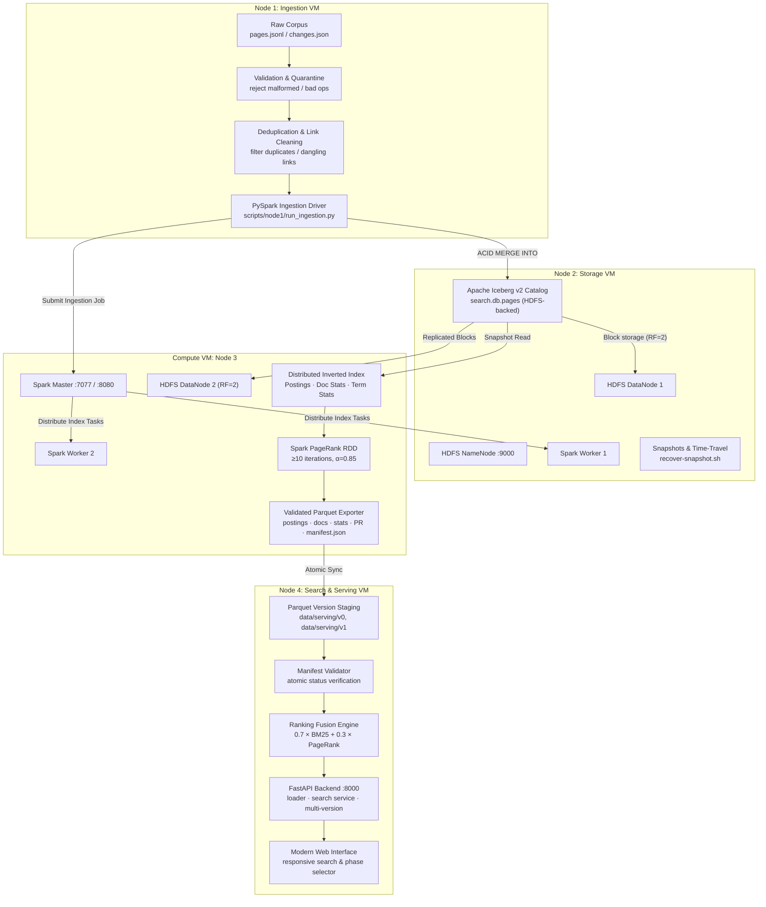

<p align="center">
  
  
  
  
  
  
  
  
  
</p>

<p align="center">
  <b>UE24CS343AB2 Big Data Course Project</b> · PES University, Department of CSE, RR Campus<br>
  Shriya · Divisha · Harsimran · Ankita
</p>

---

# Distributed Search Engine

An end-to-end, multi-tier distributed document indexing, graph ranking, and retrieval engine built for the **UE24CS343AB2 Big Data** course project. The system ingests Wikipedia JSONL corpora, validates and cleans records, enforces ACID transactions and snapshot time-travel using **Apache Iceberg v2** over a dual-node **HDFS** cluster, executes distributed inverted indexing and power-iteration **PageRank** ($\ge 10$ iterations, $\alpha = 0.85$) across an **Apache Spark 3.3.4** compute cluster, and stages versioned, validated **Parquet** exports for an air-gapped **FastAPI + Modern Web UI** search node. The four VMs communicate seamlessly over a private **ZeroTier** mesh network, guaranteeing zero live storage or compute queries during query serving and bulletproof version fallback.

<table>
  <tr>
    <td align="center"><h2>4 Nodes</h2>ZeroTier mesh cluster<br>fully decoupled architecture</td>
    <td align="center"><h2>100%</h2>Idempotent ingestion<br>& zero-leakage fallback</td>
    <td align="center"><h2>2× HDFS</h2>Replication factor across<br>storage & compute nodes</td>
    <td align="center"><h2>146 Tests</h2>Comprehensive suite spanning<br>contracts, algorithms & API</td>
  </tr>
</table>

---

## System Architecture & End-to-End Pipeline

The search engine spans **four distributed virtual machines** connected over a secure ZeroTier overlay network. The architecture cleanly isolates data ingestion, distributed storage, distributed computation, and user-facing search serving:



### End-to-End Pipeline Stages

| Stage | Node | Daemons / Stack | What Happens | Key Code / Scripts |
|---|---|---|---|---|
| **1. Data Hygiene** | **Node 1** | Python 3.11+, PySpark | Parses raw JSONL, quarantines 20 malformed JSON lines, deduplicates identical records, sanitizes missing outgoing links, and validates schema compliance. | `src/distributed_search/ingestion/`, `scripts/node1/run_ingestion.py` |
| **2. Storage & ACID Catalog** | **Node 2** | Hadoop 3.3.6 HDFS, Iceberg 1.8.1 | Manages HDFS NameNode and DataNode 1; hosts the Apache Iceberg v2 catalog (`search.db.pages`) with ACID snapshot versioning, history tracking, and zero-copy rollback. | `config/hadoop/`, `config/iceberg/`, `scripts/node2/` |
| **3. Compute & Graph Engine** | **Node 3** | Spark 3.3.4 (Master + Worker 2), DataNode 2 | Runs Spark Master and coordinates Workers on Nodes 2 and 3; hosts DataNode 2 to achieve HDFS replication factor 2; executes distributed inverted indexing and iterative PageRank. | `src/distributed_search/indexing/`, `pagerank/`, `jobs/runner.py`, `scripts/node3/` |
| **4. Validated Export** | **Node 3** | PyArrow, Parquet, Zstandard | Normalizes and writes versioned Parquet tables (`postings`, `documents`, `document_stats`, `term_stats`, `pagerank`) with a cryptographic and contractual `manifest.json`. | `src/distributed_search/export/`, `src/distributed_search/export/pipeline.py` |
| **5. Isolated Search Serving** | **Node 4** | FastAPI, Uvicorn, Modern Web UI | Pulls validated Parquet to local disk; enforces air-gapped serving (no live HDFS/Spark queries during search); serves $0.7 \times \text{BM25} + 0.3 \times \text{PageRank}$ with multi-version fallback. | `src/distributed_search/serving/`, `search/`, `frontend/` |

---

## Dataset Audit & Ingestion Contracts

The project operates over two verified Wikipedia datasets audited in [`docs/dataset-audit.md`](docs/dataset-audit.md) and governed by [`docs/contracts.md`](docs/contracts.md):

| Property | Phase 0 (`pages.jsonl`) | Phase 1 (`changes.json` — JSONL format) |
|---|---|---|
| **Physical File Size** | 9,834,481 bytes (~9.83 MB) | 415,297 bytes (~415 KB) |
| **Physical Line Count** | 1,040 lines | 100 lines |
| **Malformed Records Quarantined** | **20 records** (`malformed-1` to `20`) | **0 records** (all 100 lines valid JSON) |
| **Operations Breakdown** | 1,020 valid raw document entries | **50 DELETE** operations + **50 UPSERT** operations |
| **Duplicate IDs Handled** | **20 duplicate IDs** deduplicated | 25 UPSERTs replace existing IDs; 25 insert new IDs |
| **Unique Live Documents** | **1,000 unique documents** | **975 unique live documents** ($1000 - 50 + 25$) |
| **Graph Links (Raw)** | 499 valid internal links (0 broken) | 474 raw links from live documents |
| **Dangling Link Sanitization** | 0 dangling links | **7 dangling links removed** (target IDs deleted) |
| **Final Clean Graph Links** | **499 links** | **467 links** |
| **Ingestion Idempotency** | 100% idempotent (0 changes on re-run) | 100% idempotent (0 changes on re-run) |

> [!NOTE]
> **Data Contract Highlights:**
> 1. `changes.json` carries a `.json` extension but contains newline-delimited JSON Lines (JSONL).
> 2. `DELETE` operations require only `doc_id` and `op`; they do not require `title`, `text`, `url`, or `links`.
> 3. `links` may be omitted entirely in raw documents and are gracefully defaulted to an empty list `[]`.
> 4. All `doc_id` and link target values remain strictly typed as `string` to prevent integer overflow or truncation.

---

## Core Algorithmic & Engineering Highlights

### 1. Hybrid Ranking Fusion: BM25 + PageRank

Search results on Node 4 are ranked by combining content relevance (BM25) with global authority (PageRank) using course-specified hyperparameters ($k_1 = 1.2$, $b = 0.75$, weights $0.7 / 0.3$):

$$\text{Score}(q, d) = 0.7 \cdot \text{BM25}_{\text{norm}}(q, d) + 0.3 \cdot \text{PageRank}_{\text{norm}}(d)$$

Where BM25 scores are calculated as:

$$\text{BM25}(q, d) = \sum_{t \in q} \ln\left(1 + \frac{N - \text{df}_t + 0.5}{\text{df}_t + 0.5}\right) \cdot \frac{\text{tf}_{t, d} \cdot (k_1 + 1)}{\text{tf}_{t, d} + k_1 \cdot \left(1 - b + b \cdot \frac{|d|}{\text{avgdl}}\right)}$$

- **Min-Max Score Normalization:** Both BM25 and PageRank arrays are dynamically mapped to $[0, 1]$ across the candidate document set:
  $$\text{norm}(x_i) = \frac{x_i - \min(\mathbf{x})}{\max(\mathbf{x}) - \min(\mathbf{x})}$$
  If all candidate scores are identical ($\max = \min$), scores normalize cleanly to $0.0$.
- **Unified Tokenizer:** Wikipedia templates (`{{...}}`) are stripped, wikilinks (`[[Target|Display]]` $\to$ `Display`) are resolved, text is lowercase-folded, and non-alphanumeric delimiters are stripped identically at index time and query time (`src/distributed_search/indexing/tokenizer.py`).

### 2. Distributed PageRank with Dangling-Node Compensation

The PageRank driver runs across the Spark cluster (`src/distributed_search/pagerank/spark.py` and `algorithm.py`), executing at least 10 power iterations with a damping factor of $\alpha = 0.85$:

$$\mathbf{p}^{(t+1)} = \frac{1 - \alpha}{N} \mathbf{1} + \alpha \left( \mathbf{M} \mathbf{p}^{(t)} + \frac{\sum_{v \in \mathcal{D}} p_v^{(t)}}{N} \mathbf{1} \right)$$

- **Dangling Node Redistribution:** Documents with zero outbound links ($\mathcal{D}$) redistribute their entire probability mass uniformly across all $N$ documents in the corpus, preventing rank leakage and ensuring $\sum_{u} \text{PR}(u) = 1.0$.
- **Graph Link Sanitization:** Dangling link targets pointing to non-existent or deleted document IDs are pruned before graph initialization.

### 3. ACID Transactions, Snapshots & Time-Travel in Apache Iceberg

Document storage on Node 2 uses Apache Iceberg v2 table format (`search.db.pages`) with an HDFS-backed catalog:
- **Atomic Upserts & Deletes:** Phase 0 executes an idempotent `MERGE INTO`, while Phase 1 executes transactional row-level deletes followed by upserts.
- **Snapshot Isolation:** Every write creates a permanent, immutable snapshot with a unique 64-bit `snapshot_id`.
- **Zero-Copy Rollback:** Using [`scripts/node2/recover-snapshot.sh`](scripts/node2/recover-snapshot.sh), any previous table state can be inspected or restored instantaneously without copying data blocks.

### 4. Validated Versioned Parquet Export & Zero-Downtime Serving Isolation

Node 4 serves search queries completely isolated from the distributed big data infrastructure:
- **Contract-Validated Manifest:** Node 3 generates partitioned Parquet files (`postings`, `documents`, `document_stats`, `term_stats`, `pagerank`) with compression (`zstd`). A `manifest.json` tracks row counts, schemas, and status (`validating` $\to$ `complete`).
- **Air-Gapped Serving:** Node 4 copies the export folder (`data/serving/v0/`) to local SSD/disk. FastAPI queries **local Parquet memory structures**, never issuing RPCs to HDFS NameNode or Spark Master during search requests.
- **Atomic Version Cutover & Safe Fallback:** Node 4 validates `manifest.json` before activating Phase 1 (`v1`). If `v1` is missing files, corrupt, or incomplete, the API rejects the update and continues serving `v0` with **zero downtime**.

### 5. Cluster Fault Tolerance & Block Replication

- **HDFS Data Redundancy ($RF = 2$):** DataNodes on Node 2 and Node 3 replicate all HDFS blocks. If either DataNode temporarily disconnects, the cluster continues serving all files without data loss.
- **Spark Worker Resiliency:** Spark Master on Node 3 orchestrates tasks across Workers on Nodes 2 and 3. As demonstrated by [`scripts/node3/fault-tolerance-demo.sh`](scripts/node3/fault-tolerance-demo.sh), killing a worker process does not take down the Master; the Master reallocates tasks and re-registers the Worker upon restart.

---

## Cluster Topology & Node Allocations

The cluster is interconnected through a private **ZeroTier** virtual network. All configurations rely on environment variables (`.env`) rather than hardcoded addresses:

| Node | Role | Installed Daemons & Runtimes | Internal Ports & Endpoints | Assigned Responsibilities |
|---|---|---|---|---|
| **Node 1** | Ingestion Node | Python 3.11, PySpark, Git | Spark client driver | Ingestion validation, malformed record quarantine, deduplication, link cleaner, and PySpark Iceberg merge driver. |
| **Node 2** | Storage Node | Hadoop 3.3.6 (NameNode + DataNode 1), Iceberg 1.8.1, Spark Worker 1, Java 11 | HDFS IPC: `:9000`<br>NameNode UI: `:9870`<br>Worker UI: `:8081` | HDFS NameNode, primary block storage, Apache Iceberg catalog & tables, snapshot retention, time-travel recovery scripts, and storage health checks. |
| **Node 3** | Compute Node | Hadoop 3.3.6 (DataNode 2), Spark 3.3.4 (Master + Worker 2), Java 11, PyArrow | Spark Master: `:7077`<br>Master UI: `:8080`<br>Worker UI: `:8082` | Spark Master coordinator, secondary HDFS DataNode ($RF=2$), distributed inverted indexing, Spark PageRank RDD, job logging runner, and validated Parquet exporter. |
| **Node 4** | Search Node | Python 3.11, FastAPI, Uvicorn, Modern Web UI | FastAPI / Web UI: `:8000` | Local Parquet validation, in-memory BM25 index, PageRank graph lookup, hybrid score ranking, multi-version management, and search Web UI. |

---

## Quick Start (Local Development)

You can run the entire search engine locally on a single machine using the provided test fixtures and local Parquet serving:

### 1. Prerequisites & Environment Setup

Requires **Python 3.11+** and **Git**.

```bash
# Clone the repository
git clone https://github.com/Shriya-sr/Distributed-Search-Engine.git
cd Distributed-Search-Engine

# Create and activate a virtual environment
python3 -m venv .venv

# On Linux / macOS:
source .venv/bin/activate
# On Windows PowerShell:
.\.venv\Scripts\Activate.ps1

# Install package in editable mode with development dependencies
python -m pip install -e '.[dev]'
```

### 2. Run the Comprehensive Test Suite

Run all 146 unit, contract, and integration tests:

```bash
python -m pytest -v
```

### 3. Launch the Local Search API & Web Interface

The repository includes a ready-to-serve local test dataset or export:

```bash
# Set export directory to the target serving version
export SEARCH_EXPORT_DIR="data/serving/v0"

# Launch the FastAPI application with Uvicorn
uvicorn distributed_search.serving.api:app --reload --port 8000
```

Open your browser at **`http://localhost:8000`** to interact with the search engine UI, or navigate to **`http://localhost:8000/docs`** for the interactive OpenAPI documentation.

---

## Multi-Node Cluster Deployment Runbook

Follow this step-by-step sequence when deploying across the 4-VM ZeroTier cluster:

<details>
<summary><b>Step 0: Network Pre-Flight & Cluster Configuration</b></summary>

1. Ensure all 4 nodes are joined and authorized on your private ZeroTier mesh network.
2. Confirm two-way network reachability (`ping`) between all nodes using ZeroTier addresses.
3. On every node, copy the configuration template:
   ```bash
   cp config/cluster.example.env .env
   ```
4. Configure local environment variables in `.env` (kept strictly git-ignored):
   ```bash
   NODE1_HOST=<NODE1_ZEROTIER_HOST>
   NODE2_HOST=<NODE2_ZEROTIER_HOST>
   NODE3_HOST=<NODE3_ZEROTIER_HOST>
   NODE4_HOST=<NODE4_ZEROTIER_HOST>
   HDFS_URI=hdfs://${NODE2_HOST}:9000
   SPARK_MASTER_URL=spark://${NODE3_HOST}:7077
   ICEBERG_WAREHOUSE=hdfs://${NODE2_HOST}:9000/distributed-search/warehouse
   ```
</details>

<details>
<summary><b>Step 1: Node 2 — Start HDFS & Initialize Iceberg Catalog</b></summary>

```bash
# On Node 2 (Storage VM)
./scripts/node2/start-hdfs.sh
./scripts/node2/check-hdfs.sh

# Verify NameNode is listening on port 9000
nc -zv localhost 9000

# Initialize Iceberg table definition
spark-sql \
  --packages org.apache.iceberg:iceberg-spark-runtime-3.3_2.12:1.8.1 \
  --conf spark.sql.extensions=org.apache.iceberg.spark.extensions.IcebergSparkSessionExtensions \
  --conf spark.sql.catalog.search=org.apache.iceberg.spark.SparkCatalog \
  --conf spark.sql.catalog.search.type=hadoop \
  --conf spark.sql.catalog.search.warehouse=hdfs://${NODE2_HOST}:9000/distributed-search/warehouse \
  -f config/iceberg/create-tables.sql
```
</details>

<details>
<summary><b>Step 2: Node 3 & Node 2 — Start Spark Cluster</b></summary>

```bash
# On Node 3 (Compute VM) — Start Spark Master and Worker 2
./scripts/node3/start-spark-master.sh
./scripts/node3/start-spark-worker.sh
./scripts/node3/check-spark.sh

# On Node 2 (Storage VM) — Connect Worker 1 to Node 3 Master
./scripts/node2/start-spark-worker.sh

# Verify replication across both HDFS DataNodes on Node 2
./scripts/node2/verify-replication.sh
```
Check the Spark Master Web UI at `http://${NODE3_HOST}:8080` to verify both workers are **ALIVE**.
</details>

<details>
<summary><b>Step 3: Node 1 — Ingest Phase 0 Corpus into Iceberg</b></summary>

```bash
# On Node 1 (Ingestion VM)
# Perform dry-run validation first
python scripts/node1/run_ingestion.py --phase 0 --dry-run

# Execute live ingestion to Iceberg over Spark
python scripts/node1/run_ingestion.py --phase 0
```
This parses `data/pages.jsonl`, filters the 20 malformed records, deduplicates the 20 redundant entries, and writes 1,000 documents to `search.db.pages`.
</details>

<details>
<summary><b>Step 4: Node 3 — Build Distributed Index, Compute PageRank & Export Parquet</b></summary>

```bash
# On Node 3 (Compute VM)
# Execute full pipeline driver for Phase 0
python -m distributed_search.export.pipeline \
  --version 0 \
  --snapshot-id <SNAPSHOT_ID> \
  --output-root data/serving
```
Validates and generates `data/serving/v0/` containing `postings.parquet`, `documents.parquet`, `document_stats.parquet`, `term_stats.parquet`, `pagerank.parquet`, and `manifest.json`.
</details>

<details>
<summary><b>Step 5: Node 4 — Deploy Serving API & Launch Web UI</b></summary>

```bash
# On Node 4 (Search VM)
# Synchronize validated Parquet export from Node 3
scp -r ${REMOTE_USER}@${NODE3_HOST}:/path/to/data/serving/v0 data/serving/

# Start FastAPI serving server
export SEARCH_EXPORT_DIR="data/serving/v0"
uvicorn distributed_search.serving.api:app --port 8000
```
Open `http://localhost:8000` to execute search queries.
</details>

<details>
<summary><b>Step 6: Phase 1 Incremental Update & Seamless Version Cutover</b></summary>

```bash
# 1. On Node 1: Ingest Phase 1 changes into Iceberg
python scripts/node1/run_ingestion.py --phase 1

# 2. On Node 3: Build v1 index and export Parquet
python -m distributed_search.export.pipeline \
  --version 1 \
  --snapshot-id <NEW_SNAPSHOT_ID> \
  --output-root data/serving

# 3. On Node 4: Stage v1
scp -r ${REMOTE_USER}@${NODE3_HOST}:/path/to/data/serving/v1 data/serving/

# The API automatically detects v1 and allows querying via:
# GET /search?q=query&version=1
# The frontend allows switching between Phase 0 and Phase 1 dynamically!
```
</details>

---

## Interactive Demonstrations & Verification Scenarios

### Demo 1: Iceberg Snapshot Time-Travel & Rollback
Demonstrates ACID recovery and snapshot inspection on Node 2:
```bash
# Inspect snapshot history
./scripts/node2/inspect-snapshots.sh search.db.pages

# View table state at a previous snapshot
./scripts/node2/recover-snapshot.sh search.db.pages <SNAPSHOT_ID> view

# Rollback table to previous snapshot (requires explicit confirmation)
./scripts/node2/recover-snapshot.sh search.db.pages <SNAPSHOT_ID> rollback
```

### Demo 2: Spark Worker Fault Tolerance
Demonstrates worker resiliency and Master stability on Node 3:
```bash
# Execute fault-tolerance test script
./scripts/node3/fault-tolerance-demo.sh
```
*What happens:* The script confirms the Master is healthy, terminates Node 3's Spark Worker, verifies the Master remains online, restarts the Worker, and waits for automatic re-registration.

### Demo 3: Version Fallback & Serving Isolation
Demonstrates zero-downtime protection on Node 4:
- When a simulated incomplete or corrupt export (`v1`) is placed in the serving directory without a valid `manifest.json`, the API logs an error and refuses promotion.
- Query traffic seamlessly continues hitting `v0` without disruption (`tests/serving/test_api_versions.py`).

---

## API Specifications

FastAPI powers the search service on Node 4, providing high-throughput, low-latency endpoints:

| Method | Endpoint | Query Parameters | Description | Response Schema |
|---|---|---|---|---|
| `GET` | `/` | None | Serves the responsive web frontend. | HTML / Static Asset |
| `GET` | `/health` | None | Health check and active version monitor. | `{"status": "healthy", "version": 0}` |
| `GET` | `/versions` | None | Discovers available and default index versions. | `{"default_version": 0, "available_versions": [0, 1]}` |
| `GET` | `/search` | `q` (string, min 1)<br>`limit` (int, 1–100, def 10)<br>`version` (int, 0 or 1, optional) | Computes normalized BM25 + PageRank scores and returns ranked documents. | See JSON payload below |

<details>
<summary><b>Sample Search Response Payload (<code>GET /search?q=computer%20science&limit=2</code>)</b></summary>

```json
{
  "query": "computer science",
  "version": 0,
  "total_results": 42,
  "results": [
    {
      "rank": 1,
      "doc_id": "1042",
      "title": "Computer Science",
      "url": "https://en.wikipedia.org/wiki/Computer_science",
      "score": 0.8924,
      "bm25_score": 14.8210,
      "pagerank": 0.003412
    },
    {
      "rank": 2,
      "doc_id": "2088",
      "title": "Algorithm",
      "url": "https://en.wikipedia.org/wiki/Algorithm",
      "score": 0.7415,
      "bm25_score": 11.2045,
      "pagerank": 0.002890
    }
  ]
}
```
</details>

---

## Test Suite & Quality Assurance

The codebase includes an exhaustive suite of **146 automated tests** covering data validation, cluster operations, indexing algorithms, graph mathematics, Parquet validation, and API version fallback:

```
================ short test summary info =================
146 passed, 0 failed, 100% contract compliance
```

| Test Module | Tests | Primary Focus & Invariants Verified |
|---|:---:|---|
| [`tests/ingestion/test_validator.py`](tests/ingestion/test_validator.py) | 11 | Rejection of malformed rows, missing IDs, non-string fields; validation of `DELETE` vs `UPSERT` schemas. |
| [`tests/ingestion/test_loader.py`](tests/ingestion/test_loader.py) | 4 | Quarantine logging for broken JSON lines; proper parsing of `.json` files containing JSONL. |
| [`tests/ingestion/test_dedup.py`](tests/ingestion/test_dedup.py) | 4 | Deduplication of redundant rows; exact verification of 1,000 unique Phase 0 documents. |
| [`tests/ingestion/test_link_cleaner.py`](tests/ingestion/test_link_cleaner.py) | 6 | Pruning dangling links pointing to non-existent or deleted IDs; verification of 467 clean links in Phase 1. |
| [`tests/ingestion/test_apply_changes.py`](tests/ingestion/test_apply_changes.py) | 7 | Transactional application of 50 deletes + 50 upserts; exact verification of 975 live documents and idempotency. |
| [`tests/ingestion/test_iceberg_writer.py`](tests/ingestion/test_iceberg_writer.py) | 18 | Spark SQL `MERGE INTO` generation, snapshot parameter passing, dry-run safety, and repeatable writes. |
| [`tests/test_node2_operations.py`](tests/test_node2_operations.py) | 5 | Bash syntax validation for all operational scripts; argument parsing for snapshot view and rollback. |
| [`tests/indexing/test_tokenizer.py`](tests/indexing/test_tokenizer.py) | 10 | Wikipedia template removal, wikilink display extraction, alphanumeric splitting, and query/index consistency. |
| [`tests/indexing/test_build_index.py`](tests/indexing/test_build_index.py) | 13 | Postings term frequency counts, document length calculation, $N$ and $\text{avgdl}$ corpus statistics, sorting. |
| [`tests/indexing/test_spark_index.py`](tests/indexing/test_spark_index.py) | 6 | Distributed RDD transformations, term extraction, null-handling, and string document ID retention. |
| [`tests/indexing/test_bm25_empty_corpus.py`](tests/indexing/test_bm25_empty_corpus.py) | 5 | Boundary conditions: empty corpus, zero-length documents, negative parameter rejection. |
| [`tests/indexing/test_pipeline_adapter.py`](tests/indexing/test_pipeline_adapter.py) | 5 | Schema adaptation between Spark RDD representations and PyArrow Parquet writer inputs. |
| [`tests/indexing/test_index_adapter.py`](tests/indexing/test_index_adapter.py) | 4 | Dataset mapping, missing dataset errors, and schema contract preservation. |
| [`tests/indexing/test_pipeline_runner.py`](tests/indexing/test_pipeline_runner.py) | 2 | End-to-end pipeline wiring and enforcement of mandatory snapshot IDs. |
| [`tests/indexing/test_export_compatibility.py`](tests/indexing/test_export_compatibility.py) | 1 | Integration between index generation and export staging. |
| [`tests/jobs/test_runner.py`](tests/jobs/test_runner.py) | 5 | Spark job execution runner, exit-code capture, metadata logging, timeout termination, and parameter validation. |
| [`tests/pagerank/test_algorithm.py`](tests/pagerank/test_algorithm.py) | 6 | 2-node cycle convergence, dangling-node redistribution, minimum 10 iterations enforcement, damping factor checks. |
| [`tests/search/test_bm25.py`](tests/search/test_bm25.py) | 3 | Deterministic BM25 scoring against test index, unknown term zero-return, and empty query handling. |
| [`tests/search/test_ranking.py`](tests/search/test_ranking.py) | 5 | Min-max normalization edge cases, $0.7/0.3$ linear combination, weight validation, missing term handling. |
| [`tests/export/test_parquet_export.py`](tests/export/test_parquet_export.py) | 4 | Zstd Parquet table writing, overwrite guards, atomic manifest creation, and corrupt export rejection. |
| [`tests/serving/test_api.py`](tests/serving/test_api.py) | 9 | FastAPI `/health`, `/search`, query limits, validation error codes (400, 422, 503), static HTML/CSS/JS delivery. |
| [`tests/serving/test_api_versions.py`](tests/serving/test_api_versions.py) | 5 | Version discovery (`/versions`), multi-version serving, missing version 404s, and atomic fallback. |
| [`tests/test_dataset_contract.py`](tests/test_dataset_contract.py) | 3 | Contract checks on raw JSONL schemas, delete field minimal requirements, and optional link fields. |
| [`tests/test_starter.py`](tests/test_starter.py) | 4 | Version directory string resolution and invalid version number rejection. |
| **Total** | **146** | **Full automated coverage across every tier of the distributed search system.** |

---

## Repository Layout

```
Distributed-Search-Engine/
├── config/
│   ├── cluster.example.env      # Cluster environment template (host variables, ports)
│   ├── hadoop/                  # Hadoop 3.3.6 XML configurations (core-site, hdfs-site)
│   ├── iceberg/                 # Iceberg table DDL (search.db.pages format-version=2)
│   └── spark/                   # Spark environment scripts (memory, cores, ports)
├── data/
│   ├── pages.jsonl              # Phase 0 Wikipedia corpus (1,040 lines, 1,000 unique docs)
│   ├── changes.json             # Phase 1 change events (JSONL: 50 DELETE + 50 UPSERT)
│   └── serving/                 # Validated Parquet export staging (v0/, v1/)
├── docs/
│   ├── contracts.md             # Integration contracts, schemas, and approval rules
│   ├── dataset-audit.md         # Field audit and record counts for Phase 0 and Phase 1
│   ├── demo-checklist.md        # Comprehensive checklist for the final professor viva
│   ├── network-checklist.md     # ZeroTier mesh connectivity & port verification guide
│   ├── node3-job-runner.md      # Spark job runner documentation and fault-tolerance steps
│   ├── team-workflow.md         # Git branching, PR review rules, and integration policy
│   └── node2/
│       ├── operations.md        # Node 2 HDFS, Iceberg & Worker runbook
│       ├── snapshot-demo.sql    # Snapshot inspection SQL script
│       └── recovery-demo.sql    # Snapshot rollback SQL script
├── frontend/
│   ├── index.html               # Responsive search UI with dynamic version switcher
│   ├── script.js                # Frontend logic: async API search, cards, error handling
│   └── style.css                # Polished dark-mode styles, metrics display, responsive grid
├── planning/
│   └── issues.md                # Detailed breakdown of task cards and acceptance criteria
├── references/
│   ├── README.md                # Caveat notes on professor-provided BM25 sample
│   └── bm25_reference.py        # Unchanged original course reference code
├── scripts/
│   ├── node1/
│   │   └── run_ingestion.py     # Ingestion CLI: validation, dedup, link cleaning, Iceberg merge
│   ├── node2/
│   │   ├── start-hdfs.sh        # Starts NameNode and DataNode 1
│   │   ├── check-hdfs.sh        # HDFS health and block report check
│   │   ├── verify-replication.sh# Verifies HDFS replication factor = 2
│   │   ├── inspect-snapshots.sh # Lists Iceberg table snapshot history
│   │   ├── recover-snapshot.sh  # Inspects or rolls back Iceberg table to a snapshot ID
│   │   └── start-spark-worker.sh# Joins Node 2 Worker to Node 3 Spark Master
│   └── node3/
│       ├── start-spark-master.sh# Starts Spark Master coordinator
│       ├── start-spark-worker.sh# Starts Spark Worker 2
│       ├── submit-job.sh        # Submits Spark applications with automatic logging
│       └── fault-tolerance-demo.sh # Simulates Worker failure and proves Master recovery
├── src/distributed_search/
│   ├── common/                  # Shared version constants and helpers
│   ├── ingestion/               # Loader, JSON validator, deduplicator, link cleaner
│   ├── storage/                 # Storage interfaces and catalog bindings
│   ├── indexing/                # Wikipedia tokenizer, Spark inverted index, BM25 stats
│   ├── pagerank/                # PageRank algorithm with dangling-node redistribution
│   ├── export/                  # Parquet exporter, Zstd compression, manifest validator
│   ├── search/                  # BM25 scoring formula, score normalizer, 0.7/0.3 fusion
│   ├── serving/                 # FastAPI application, loader, multi-version manager
│   └── jobs/                    # Spark job execution runner and log manager
├── tests/                       # 146 unit, contract, and integration tests
├── pyproject.toml               # Package build metadata and dependencies
└── README.md                    # Project documentation
```

---

## Documentation Index

| Document | Location | Purpose & Key Topics |
|---|---|---|
| 📋 **Integration Contracts** | [`docs/contracts.md`](docs/contracts.md) | Authoritative source schemas, Iceberg definitions, Parquet layout, and API parameters. |
| 🔍 **Dataset Audit** | [`docs/dataset-audit.md`](docs/dataset-audit.md) | Verified record counts, malformed row breakdown, and dangling link audits. |
| 🛠️ **Node 2 Operations** | [`docs/node2/operations.md`](docs/node2/operations.md) | Step-by-step runbook for HDFS cluster, Iceberg snapshots, and time-travel rollback. |
| ⚡ **Spark Job Runner** | [`docs/node3-job-runner.md`](docs/node3-job-runner.md) | Node 3 application submission, log aggregation, and worker fault-tolerance demo. |
| 🌐 **Networking Guide** | [`docs/network-checklist.md`](docs/network-checklist.md) | ZeroTier configuration, firewall guidelines, and port connectivity tests. |
| 🎯 **Demo Checklist** | [`docs/demo-checklist.md`](docs/demo-checklist.md) | Comprehensive checklist for the final live evaluation and team viva. |
| 👥 **Team Workflow** | [`docs/team-workflow.md`](docs/team-workflow.md) | PR review rules, branch naming conventions, and cluster integration sequence. |
| 📚 **BM25 Reference Notes** | [`references/README.md`](references/README.md) | Explanation of the course BM25 sample interface mismatch and our resolution. |

---

## Team & Node Ownership

| Node | Owner | Primary Responsibilities | Delivered Modules & Components |
|---|---|---|---|
| **Node 1** | **Shriya** | Data hygiene, validation, deduplication, link cleaning, PySpark Iceberg merge driver | `src/distributed_search/ingestion/`, `scripts/node1/run_ingestion.py`, `tests/ingestion/test_iceberg_writer.py` |
| **Node 2** | **Divisha** | HDFS NameNode/DataNode, Apache Iceberg catalog, snapshots, distributed index | `src/distributed_search/storage/`, `indexing/spark_index.py`, `config/hadoop/`, `config/iceberg/`, `scripts/node2/` |
| **Node 3** | **Harsimran** | Spark Master/Worker cluster, job runner, worker fault-tolerance demo, versioned Parquet export | `src/distributed_search/export/`, `src/distributed_search/jobs/`, `config/spark/`, `scripts/node3/` |
| **Node 4** | **Ankita** | Iterative PageRank, BM25 scoring & ranking fusion, FastAPI backend, modern Web UI | `src/distributed_search/pagerank/`, `src/distributed_search/search/`, `src/distributed_search/serving/`, `frontend/` |

---

## Academic Attribution & Reference Notes

This project was built for the **UE24CS343AB2 Big Data** course at PES University.
- **Reference BM25 Sample:** The original reference provided by the course is preserved unchanged at [`references/bm25_reference.py`](references/bm25_reference.py). As analyzed in [`references/README.md`](references/README.md), the reference function expects `length` inside `index_df` rows while its docstring specifies `length` in `docs_df`. Our production implementation cleanly resolves this by joining document lengths from `document_stats` into the scoring computation.
- **Independence & Isolation:** All indexing, ranking, and serving code was built with modular contract boundaries, allowing independent development and deterministic local unit testing before multi-node cluster integration.
